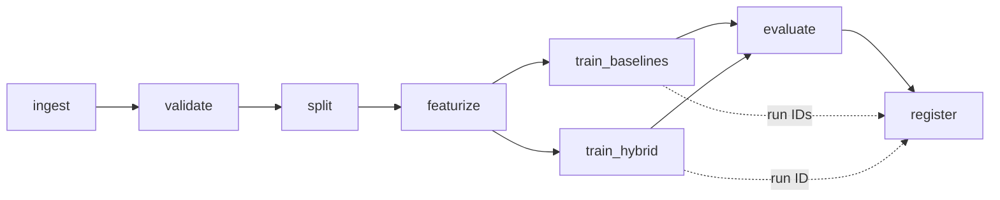

# PhishShield AI

**Phishing URL detection with a hybrid DistilBERT + engineered-feature model, as a fully reproducible ML pipeline.**

Milestone 1 covers the core ML pipeline. Data comes from its public source, passes validation checks,
and is versioned with **DVC** (remote on **DagsHub**). A baseline and a main model are trained and evaluated.
Every run is tracked in **MLflow on DagsHub**, and the main model is registered in the **Model Registry (Staging)**.
`dvc repro` rebuilds everything from scratch.

| | Link |
|---|---|
| GitHub | `https://github.com/<user>/phishshield-ai` |
| DagsHub (DVC remote + MLflow) | `https://dagshub.com/<user>/phishshield-ai` |
| MLflow tracking server | `https://dagshub.com/<user>/phishshield-ai.mlflow` |

## Models

| Role | Model | Input |
|---|---|---|
| **Baselines** | Logistic Regression, Random Forest, **XGBoost** | 31 engineered lexical/host URL features |
| **Main model** | **Hybrid DistilBERT fusion**: a fine-tuned `distilbert-base-uncased` encoder over the raw URL text, plus an MLP over the engineered features, combined by a learned gate `z = g·h_text + (1−g)·h_feat`. Calibrated with temperature scaling. The decision threshold is chosen under a false-negative-rate limit | raw URL + 31 features |

Metrics on the held-out test set: accuracy, precision, recall, **F1**, ROC-AUC, PR-AUC, **false-negative rate**
(missed phishing, the most costly error), FPR and latency.

## Dataset

**PhiUSIIL Phishing URL Dataset** (Prasad & Chandra, 2024, UCI ML Repository #967): 235,795 labelled URLs.
The `ingest` stage downloads it from UCI, records its SHA-256, maps labels to `1 = phishing`, and takes a stratified
40k-row sample (`params.yaml → data.max_rows`; set `null` for all rows).

## Pipeline (`dvc.yaml`)



| Stage | What it does | Main outputs |
|---|---|---|
| `ingest` | Download PhiUSIIL from UCI, map the schema, stratified subsample | `data/raw/urls.csv`, `reports/ingest.json` |
| `validate` | Schema, nulls, ranges (label, URL length, class balance), URL format, duplicates and conflicting labels. **Fails the pipeline** on bad data | `data/interim/urls_clean.csv`, `reports/data_validation.json` |
| `split` | Stratified 70/15/15 train/val/test | `data/processed/{train,val,test}.csv` |
| `featurize` | 31 engineered features; scaler fitted on train only | `*_features.csv`, `models/scaler.joblib` |
| `train_baselines` | LR, RF and XGBoost, each as one MLflow run with its logged model | `models/baselines/` |
| `train_hybrid` | Main model, logged to MLflow as a pyfunc model, with per-epoch metrics and a training-curve artifact | `models/hybrid/` |
| `evaluate` | All models on the test set, as an MLflow run with figures and table artifacts | `reports/metrics.json`, `model_comparison.md`, `figures/` |
| `register` | MLflow Model Registry: `phishshield-hybrid` → **Staging**, `phishshield-baseline-xgboost` registered | `reports/registry.json` |

All hyper-parameters live in `params.yaml`. DVC re-runs only the stages whose code, data or parameters changed.

## Setup

Requires Python 3.10–3.12 and Git. The step-by-step guide, including DagsHub and Colab, is in **[docs/SETUP.md](docs/SETUP.md)**.

```bash
git clone https://github.com/<user>/phishshield-ai.git && cd phishshield-ai
python -m venv .venv
source .venv/bin/activate                 # Windows: .venv\Scripts\activate
pip install torch --index-url https://download.pytorch.org/whl/cpu
pip install -r requirements-dev.txt
pip install -e .

cp .env.example .env                      # fill in DagsHub username + token
dvc remote modify origin --local auth basic
dvc remote modify origin --local user <dagshub-user>
dvc remote modify origin --local password <dagshub-token>
```

## How to run

```bash
dvc pull            # get the versioned data + models of this commit (optional)
dvc repro           # run / update the pipeline (runs are logged to DagsHub MLflow)
dvc repro -f        # force a full rebuild from scratch
dvc push            # upload data + models to the DagsHub DVC remote

dvc dag             # pipeline diagram
dvc metrics show    # metrics of every stage
pytest              # unit tests
```

The real DistilBERT needs a GPU. Run `notebooks/colab_run_pipeline.ipynb` on a free Colab T4 (about 20 minutes).
For a quick CPU smoke test only, set `PHISHSHIELD_TINY=1`, which uses a 2-layer transformer built offline.

Load the registered model anywhere:

```python
import mlflow, pandas as pd
model = mlflow.pyfunc.load_model("models:/phishshield-hybrid/Staging")
model.predict(pd.DataFrame({"url": ["http://paypa1-secure-login.xyz/verify"]}))
```

## Results (test set)

*Generated in `reports/model_comparison.md` by `dvc repro`. Paste the table from the final GPU run here.*

## Folder structure

```
phishshield-ai/
├── dvc.yaml                 # pipeline stages
├── dvc.lock                 # exact hashes of the last run (committed)
├── params.yaml              # all parameters
├── requirements*.txt
├── .env.example             # template for DagsHub/MLflow credentials (.env is git-ignored)
├── src/phishshield/
│   ├── data/                # ingest.py, validate.py, split.py, make_sample.py (offline test data)
│   ├── features/            # lexical.py (31 features), char_tokenizer.py, build.py
│   ├── models/              # baselines.py, hybrid.py (main model), pyfunc.py (MLflow wrapper)
│   ├── training/            # train_baselines.py, train_hybrid.py, hybrid_trainer.py, common.py
│   ├── evaluation/          # metrics.py, evaluate.py
│   ├── registry/            # register.py (MLflow Model Registry -> Staging)
│   └── utils/               # tracking.py (MLflow), common.py
├── tests/                   # pytest unit tests
├── notebooks/               # colab_run_pipeline.ipynb
├── scripts/                 # bootstrap.sh / bootstrap.ps1 (DVC remote setup)
├── docs/SETUP.md            # full setup guide
├── reports/                 # metrics, tables, figures (small, committed)
├── data/, models/           # DVC-managed, git-ignored
└── .github/workflows/ci.yml # lint + tests
```

No raw data or model weights are committed to Git. `data/` and `models/` are git-ignored and versioned by DVC.

## Author

Khadija Bilal (23L-3054)
