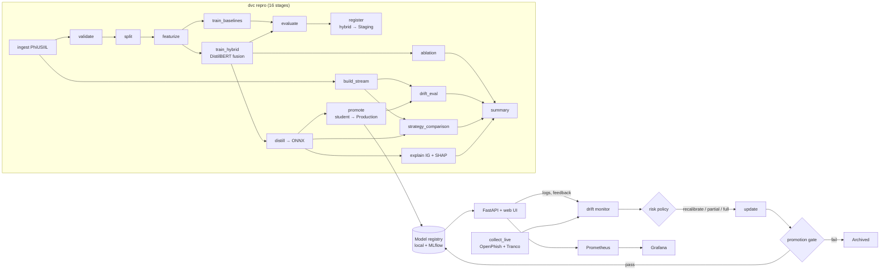

# PhishShield AI

**A drift-aware hybrid transformer framework for adaptive phishing URL detection.**

PhishShield AI detects phishing URLs with a **hybrid DistilBERT + engineered-feature fusion model**.
It distils that model into a fast **ONNX student** for serving and watches incoming traffic for
**feature-level and embedding-level drift**. When drift is found it responds with a **tiered, risk-based
update** (recalibrate → partial fine-tune → full retrain). Every candidate is validated against the
current champion, and models are promoted or rolled back through the **MLflow Model Registry**.
The whole system runs on a reproducible DVC pipeline with experiment tracking on DagsHub.

| | Link |
|---|---|
| GitHub | https://github.com/Khadija-Bilal244/PhishShieldAI |
| DagsHub (DVC remote + MLflow) | https://dagshub.com/Khadija-Bilal244/PhishShieldAI |
| MLflow tracking server | https://dagshub.com/Khadija-Bilal244/PhishShieldAI.mlflow |

## Contributions (from the proposal)

| # | Contribution | Code |
|---|---|---|
| 1 | **Hybrid transformer–feature fusion.** DistilBERT over the raw URL plus an MLP over 31 features, combined by a learned gate `z = g·h_text + (1−g)·h_feat` | `models/hybrid.py` |
| 2 | **Embedding-aware drift detection.** MMD permutation test and a domain-classifier AUC on teacher embeddings, plus PSI/KS and Evidently on features | `drift/` |
| 3 | **Tiered risk-based updates.** A risk score picks recalibration, partial fine-tuning or full retraining, with an FNR safety override | `drift/risk_policy.py`, `pipeline/update.py` |
| 4 | **Knowledge distillation.** The teacher is distilled into a CharCNN student exported to ONNX. The API serves it with no torch dependency | `training/distill.py`, `api/predictor.py` |
| 5 | **Explainability.** Integrated Gradients (Captum) on the teacher, plus SHAP for the engineered features (offline with the `shap` library; live in the API with a lightweight permutation-SHAP estimator) | `explain/run.py`, `api/predictor.py` |
| 6 | **Safe promotion and rollback.** Candidate vs champion on the same data. MLflow stages Staging → Production / Archived | `registry/` |

## System overview



## Experiments

`dvc repro` writes every table to **`reports/final_results.md`** and logs each run to MLflow:

| ID | Question | Stage |
|---|---|---|
| E1 | Do the hybrid model and the student beat the classical baselines? | `evaluate`, `distill` |
| E2 | How much does each branch contribute (fusion vs text-only vs features-only)? | `ablation` |
| E3 | Accuracy, size and latency of the distilled student vs the teacher | `distill` |
| E4 | Which drift signals react to new attack styles, and which tier the policy chooses | `drift_eval` |
| E5 | Static vs fixed-schedule vs tiered drift-aware updating: accuracy vs compute cost | `strategy_comparison` |
| E6 | Which tokens and features drive predictions | `explain` |

E4 and E5 use a **controlled drift stream**: unseen PhiUSIIL URLs with a growing share (0 → 60%) of
newer attack styles. Report it separately from **real live data** (`collect_live`: OpenPhish + Tranco
collected after training), which serves as the time-based "train on older, test on newer" check.

## MLOps tools

| Area | Tool |
|---|---|
| Code / collaboration | Git, GitHub (branches, PRs), pre-commit, Ruff |
| Data + pipeline versioning | **DVC** with **DagsHub** remote |
| Tracking + registry | **MLflow** on DagsHub (runs, artifacts, Staging/Production/Archived) |
| Data quality | validation gate (schema, nulls, ranges, duplicates) |
| Drift monitoring | **Evidently**, PSI/KS, MMD, domain classifier |
| Orchestration | **Apache Airflow**: daily adaptive loop + weekly training DAG |
| Serving | **FastAPI** + ONNX Runtime + SHAP, vanilla JS web UI |
| Containers | **Docker**, **Docker Compose** |
| CI / CT / CD / CM | **GitHub Actions**: CI, Reproducibility, CD (GHCR + Render), daily Drift Monitor |
| Operational monitoring | **Prometheus** + **Grafana** + alert rules |
| Cloud deployment | **Render** free web service (Docker image from GHCR), **Kubernetes** manifests (minikube / Docker Desktop) |

## Cost: every tool is free

| Need | Tool | Free tier used |
|---|---|---|
| Code, CI/CD | GitHub + GitHub Actions | public repo: unlimited Actions minutes |
| Container registry | GitHub Container Registry (GHCR) | free for public images |
| Data/model storage + MLflow server | DagsHub | free plan (DVC storage + hosted MLflow) |
| GPU training | Google Colab / Kaggle | free T4 GPU |
| Public deployment | Render | free web service (512 MB, 750 h/month), no card |
| Pretrained model | Hugging Face `distilbert-base-uncased` | open weights |
| Data | PhiUSIIL (UCI), OpenPhish community feed, Tranco | free / open |
| Pipeline, tracking, drift, serving | DVC, MLflow, Evidently, Captum, SHAP, FastAPI, ONNX Runtime | open source |
| Orchestration, monitoring, containers | Airflow, Prometheus, Grafana, Docker, Kubernetes (minikube) | open source, run locally |

No credit card is needed anywhere.

## Quick start

```bash
git clone https://github.com/Khadija-Bilal244/PhishShieldAI.git && cd PhishShieldAI
python -m venv .venv && source .venv/bin/activate        # Windows: .venv\Scripts\activate
pip install torch --index-url https://download.pytorch.org/whl/cpu
pip install -r requirements-dev.txt && pip install -e .
cp .env.example .env                                     # DagsHub username + token
dvc remote modify origin --local auth basic
dvc remote modify origin --local user <dagshub-user>
dvc remote modify origin --local password <dagshub-token>
dvc pull                       # data + all trained models of this commit
dvc status                     # "Data and pipelines are up to date"
uvicorn phishshield.api.main:app --port 8000             # http://localhost:8000
```

The step-by-step guides are in **[`docs/`](docs/)**. Start with
[`docs/00_UPGRADE_FROM_MILESTONE1.md`](docs/00_UPGRADE_FROM_MILESTONE1.md).

## Key commands

| Task | Command |
|---|---|
| Reproduce / update everything | `dvc repro` (GPU: `notebooks/colab_run_pipeline.ipynb`) |
| Pipeline diagram / metrics | `dvc dag` · `dvc metrics show` |
| Collect today's real data | `python -m phishshield.data.collect_live` |
| Drift check on a batch | `python -m phishshield.drift.monitor --batch <csv>` |
| Execute the policy's decision | `python -m phishshield.pipeline.update --batch <csv>` |
| Registry status / rollback | `python -m phishshield.registry.promote --status` / `--rollback` |
| Version the registry after updates | `dvc add models/registry && dvc push` |
| API + monitoring stack | `docker compose up -d --build` |
| Airflow | `docker compose -f docker-compose.airflow.yml up -d --build` |
| Tests | `pytest` (51 tests) |

## Folder structure

```
PhishShieldAI/
├── dvc.yaml · dvc.lock · params.yaml       # pipeline, exact run state, all parameters
├── src/phishshield/
│   ├── data/          ingest, validate, split, build_stream, collect_live, make_sample
│   ├── features/      lexical (31 features), char_tokenizer, build
│   ├── models/        hybrid (teacher), student (CharCNN), baselines, MLflow pyfunc wrappers
│   ├── training/      train_baselines, train_hybrid, ablation, distill, calibration, trainers
│   ├── evaluation/    metrics, evaluate
│   ├── explain/       Integrated Gradients + SHAP
│   ├── drift/         feature_drift, embedding_drift, risk_policy, monitor, drift_eval
│   ├── pipeline/      update (tiered updates + promotion gate)
│   ├── registry/      register (milestone 1), model_registry + promote (versions, gate, rollback)
│   ├── experiments/   strategy_comparison
│   ├── reporting/     summary -> reports/final_results.md
│   └── api/           FastAPI app, ONNX predictor, schemas
├── web/               production web UI (no framework)
├── tests/             pytest suite
├── airflow/           DAGs + image
├── docker/ · docker-compose*.yml
├── monitoring/        Prometheus config + alerts, Grafana dashboard
├── k8s/               Deployment, Service, HPA
├── .github/workflows/ ci, reproducibility, cd, drift-monitor
├── notebooks/         colab_run_pipeline.ipynb (GPU)
├── scripts/           bootstrap, load test
├── render.yaml        free Render deployment (blueprint)
├── reports/           metrics, tables, figures (committed, small)
└── data/, models/     DVC-managed (git-ignored); models/registry.dvc is committed
```

## Author

Khadija Bilal (23L-3054), MLOps course project, FAST-NUCES Lahore.
